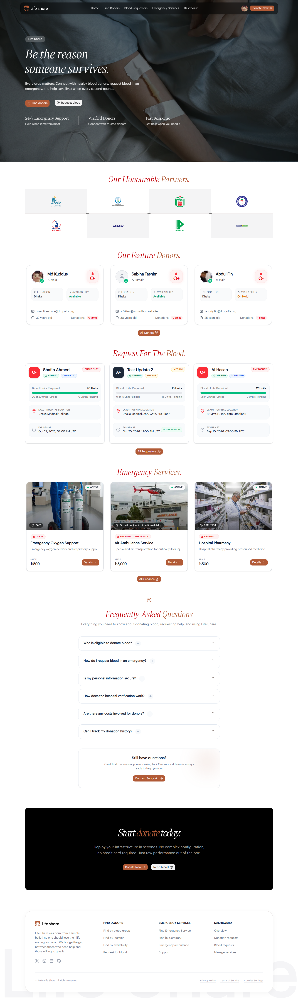
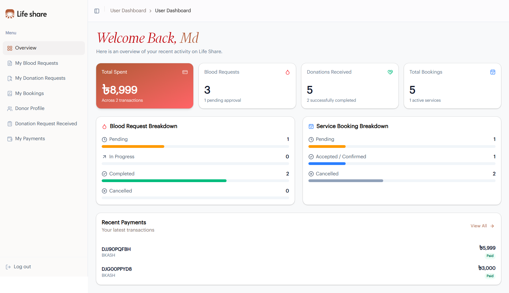
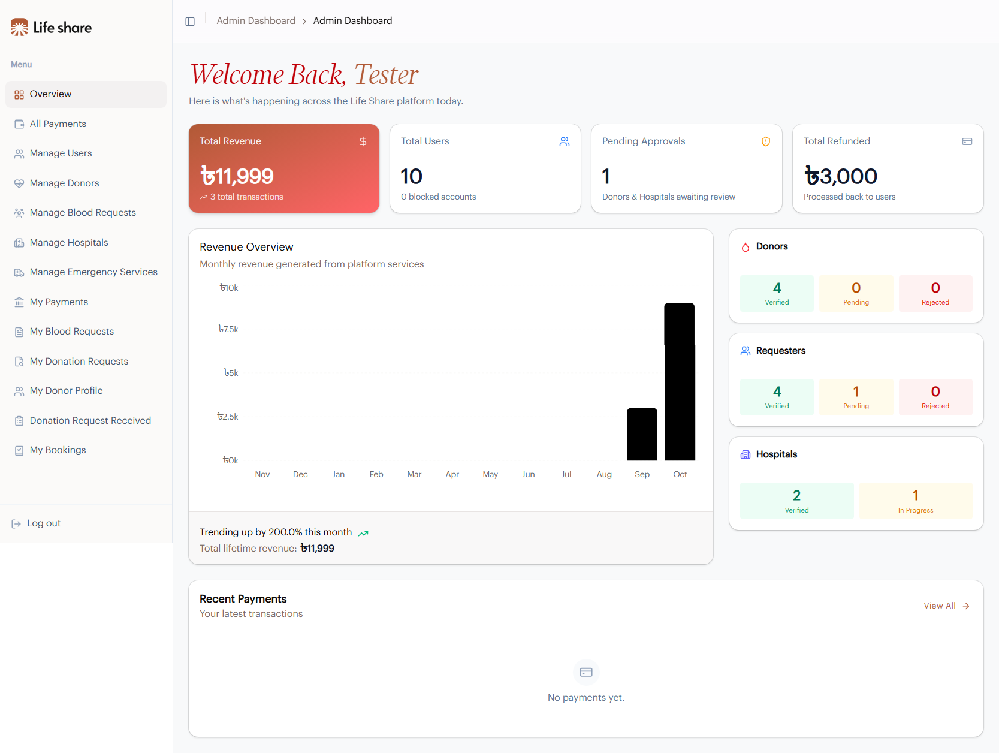
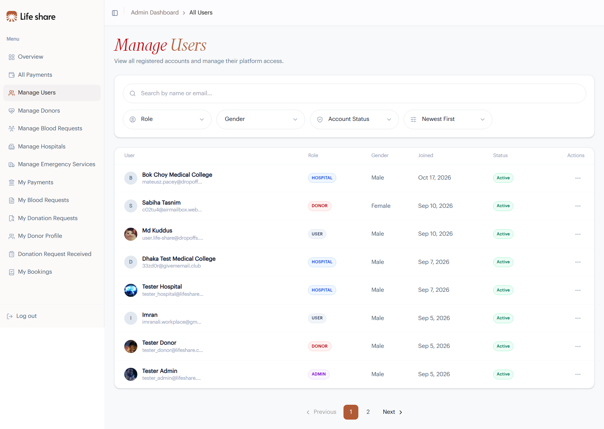

<p align="center">
  
</p>

<h1 align="center">Life Share</h1>

<p align="center">
  <strong>A blood donation & emergency medical services platform that connects blood seekers, donors, and hospitals in real time.</strong>
</p>

<p align="center">
  <a href="https://life-share-v1.vercel.app">Live Demo</a> ·
  <a href="https://life-share-backend-a6.vercel.app">Backend API</a>
</p>

---

## About The Project

**Life Share** was born from a simple belief: no one should lose their life waiting for blood. We bridge the gap between those who need help and those willing to give it.

The platform lets patients (requesters) post blood requests with urgency levels and expiry windows, lets donors get matched and accept donation requests, and lets hospitals publish and monetize emergency services (ambulance, oxygen support, pharmacy, blood bank, lab tests) with secure payments through **bKash**.

Four role-based experiences power the system:

| Role | Purpose |
| :--- | :--- |
| **USER** | Post & manage blood requests, book emergency services, become a donor, track payments |
| **DONOR** | Receive, accept/reject, and complete donation requests |
| **HOSPITAL** | Manage hospital profile, emergency services CRUD, incoming bookings, refunds |
| **ADMIN** | Platform-wide moderation: users, donors, hospitals, requests, services, payments, refunds & revenue analytics |

## Screenshots

### Landing Page
Hero, partner hospitals, featured donors, live blood requests, emergency services, and FAQ.



### User Dashboard
KPIs for spending, blood requests, donations and bookings, plus breakdown charts and recent payments.



### Admin Dashboard
Revenue overview chart, platform-wide stats for donors, requesters and hospitals, and recent payments.



### Admin - User Management
Search, filter by role/gender/status, and manage every registered account with block/unblock actions.



## Features

### Public
- **Find Donors** - browse verified donors by blood group, availability, and location; view donor details and send donation requests
- **Blood Requesters** - explore live requests filtered by urgency, blood group and status
- **Emergency Services** - catalogue of hospital services with categories (Ambulance, Oxygen Support, Pharmacy, Blood Bank, Lab Test), pricing, and direct booking
- **Auth flow** - register (user/donor/hospital) with email OTP verification, login, forget/reset password
- **One-click demo logins** - try Admin, Hospital and Donor accounts instantly from the login/register pages

### Dashboards
- **User** - post/edit/cancel blood requests, manage donation requests, edit bookings, payments history, donor-profile onboarding
- **Donor** - donation-request inbox with accept/reject/schedule/complete flow, donor analytics
- **Hospital** - hospital profile management, emergency-service CRUD, booking request management, refund workflow
- **Admin** - manage all users/donors/hospitals/requests/services, refunds, and revenue analytics chart

### Payments
- **bKash gateway integration** - fully server-driven; Pay Now redirects to the gateway and returns via `/payment?status=...`
- Refund states: `REFUNDED_PENDING` and `REFUNDED` with hospital approval flow

## Tech Stack

| Layer | Technology |
| :--- | :--- |
| Framework | [Next.js](https://nextjs.org) 16 (App Router) + React 19 |
| Language | TypeScript (strict) |
| Styling | Tailwind CSS v4, shadcn/ui (Radix), tw-animate-css |
| State (server) | TanStack Query v5 |
| Forms | TanStack Form v1 + Zod v4 validation |
| HTTP | ofetch (typed API client, cookie-session auth) |
| Payments | bKash gateway (backend-driven) |
| Charts & UI extras | Recharts, Framer Motion, Sonner, Lottie (dotLottie) |
| Lint/Format | Biome |
| Deployment | Vercel |

## Getting Started

### Prerequisites

- Node.js 20+
- npm

### Installation

1. Clone the repository

```bash
git clone https://github.com/IGNIT3-xD/Life_Share_Frontend_A7.git
cd life-share-frontend-a7
```

2. Install dependencies

```bash
npm install
```

3. Create a `.env.local` file and configure the environment variables:

```env
# Backend API (optional - falls back to the deployed backend)
BACKEND_API=https://life-share-backend-a6.vercel.app
NEXT_PUBLIC_BACKEND_API=https://life-share-backend-a6.vercel.app

# Demo/tester accounts (server-only, power the one-click demo logins)
TESTER_ADMIN_NAME="Tester Admin"
TESTER_ADMIN_EMAIL="tester_admin@lifeshare.com"
TESTER_ADMIN_PASSWORD="..."
TESTER_DONOR_NAME="Tester Donor"
TESTER_DONOR_EMAIL="tester_donor@lifeshare.com"
TESTER_DONOR_PASSWORD="..."
TESTER_HOSPITAL_NAME="Tester Hospital"
TESTER_HOSPITAL_EMAIL="tester_hospital@lifeshare.com"
TESTER_HOSPITAL_PASSWORD="..."
```

4. Run the development server

```bash
npm run dev
```

Open [http://localhost:3000](http://localhost:3000) in your browser.

### Scripts

| Command | Description |
| :--- | :--- |
| `npm run dev` | Start the development server |
| `npm run build` | Create a production build |
| `npm run start` | Start the production server |
| `npm run lint` | Run Biome checks |
| `npm run format` | Format with Biome |

## Project Structure

```
src/
  app/
    (public)/            # Landing, donors, blood requesters, emergency services
    (auth)/              # Login, register (OTP verification), password reset
    (private)/
      (dashboard)/       # Role-based dashboards
        admin-dashboard/       # [ADMIN] moderation, analytics, refunds
        user-dashboard/        # Blood requests, bookings, payments, donor profile
        donor-dashboard/       # Donation-request inbox
        hospital-dashboard/    # Hospital profile, services, bookings
      payment/           # Gateway result page (?status=success|failure|cancel)
      profile/           # Shared account profile
  api/                   # Typed ofetch service layer (auth, donors, bookings, ...)
  hooks/                 # TanStack Query hooks per domain
  components/            # Navbar, Footer, shared UI (shadcn) and AuthGuard
  constants/             # Enums, statuses, role-based dashboard navigation
  contexts/              # Dashboard context (user/role provider)
  providers/             # QueryClient provider (SSR-safe)
```

## Security & Auth

- **Cookie-based sessions** - access and refresh tokens live in `HttpOnly` cookies; never handled by client JavaScript
- **Custom `AuthGuard`** - layout-level guard chain: authentication on all private routes + per-section role allowlists (e.g. only `ADMIN` can enter `/admin-dashboard/*`), with automatic redirect to `/login` or the user's own dashboard
- **Server-rendered auth state** - the public layout resolves the session on the server and seeds React Query, so the navbar renders its final state on first paint with no hydration flicker

## Deployment

The project is deployed on [Vercel](https://vercel.com):

- Frontend: [https://life-share-v1.vercel.app](https://life-share-v1.vercel.app)
- Backend API: [https://life-share-backend-a6.vercel.app](https://life-share-backend-a6.vercel.app)

Environment variables (`BACKEND_API`, `NEXT_PUBLIC_BACKEND_API`, `TESTER_*`) are configured per environment in the Vercel project settings.

## Roadmap

- [ ] Google OAuth login
- [ ] Live blood-request notifications (WebSockets)
- [ ] Donor location-based search
- [ ] Donation certificate generation

## Author

Built as a full-stack project.

- Mail - md.imranali2046@gmail.com  
- LinkedIn - https://www.linkedin.com/in/imran-ali-mern

---

<p align="center">
  <em>Every drop matters - be the reason someone survives.</em>
</p>
